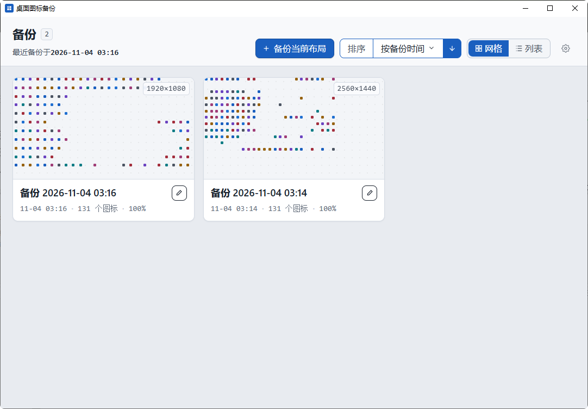
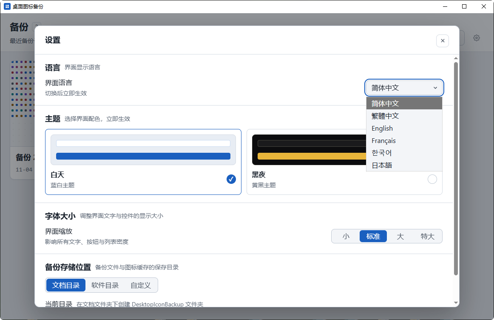

# 桌面图标备份管理器

[简体中文](#简介) | [English](#desktop-icon-backup-manager)

[](https://github.com/qcytkk/win-desktop-icon-backup-manager/releases)
[](https://github.com/qcytkk/win-desktop-icon-backup-manager)
[](https://tauri.app)
[](https://vuejs.org)
[](https://www.typescriptlang.org)

Windows 桌面图标布局的备份、预览与恢复工具，基于 Tauri 2 + Rust + Vue 3 + TypeScript，离线运行，不联网。

| 主界面 | 设置 |
| --- | --- |
|  |  |

## 简介

换分辨率、改缩放比例、插拔外接显示器或重装系统之后，Windows 桌面图标的位置经常被打乱，手动排布几十上百个图标非常费时。

本工具会在备份时记录图标名称与坐标、屏幕分辨率 / DPI / 缩放比例，以及注册表中 `IconLayouts` 的原始二进制数据；需要时可以把图标按原坐标放回桌面。

## 功能

- **备份当前布局** — 一键采集分辨率、缩放、全部桌面图标及坐标，自动生成可编辑的备份名称。
- **备份管理** — 网格 / 列表双视图，支持按名称、备份时间、分辨率、图标总数排序与升降序切换；支持行内重命名、删除（二次确认），偏好本地持久化。
- **布局预览** — 按备份分辨率等比缩放的画布，图标按真实坐标渲染，悬停显示图标名与坐标；点击「预览布局」打开，不会误触。
- **恢复布局** — 按完整路径 / 系统 CLSID 优先匹配图标，显示名兜底；备份中存在但当前已删除的图标跳过；备份之后新增的图标自动放入桌面空位。
- **跨分辨率使用布局** — 同缩放模式下可直接把低分辨率布局套用到高分辨率屏幕，坐标不做放大，超出屏幕的坐标自动贴边。
- **缩放不一致提示** — 当前系统缩放与备份记录不同时，弹窗选择使用当前缩放或备份缩放，仅做本次坐标换算，不修改系统设置。
- **界面设置** — 白天蓝白 / 黑夜黄黑双主题、6 种界面语言（简中 / 繁中 / 英 / 法 / 韩 / 日）、4 档全局字号、三种备份存储位置（文档目录 / 软件目录 / 自定义），均持久化保存。
- **无障碍** — 交互控件满足 WCAG AA 对比度，支持键盘操作与读屏器。

## 下载

从 [Releases](https://github.com/qcytkk/win-desktop-icon-backup-manager/releases) 下载：

- `桌面图标备份_<版本>_x64-setup.exe` — NSIS 安装包（当前用户安装）
- `桌面图标备份.exe` — 便携版，双击即用

系统要求：Windows 10 / 11（x64），WebView2 运行时。

## 从源码构建

环境要求：Node.js 18+、Rust stable、Microsoft C++ Build Tools（MSVC）。

```bash
# 安装前端依赖
npm install

# 开发模式（热更新）
npm run tauri dev

# 构建发布版
npm run tauri build
```

构建产物：

- 便携版：`src-tauri/target/release/desktop-icon-backup.exe`
- 安装包：`src-tauri/target/release/bundle/nsis/桌面图标备份_<版本>_x64-setup.exe`

## 数据与隐私

全部数据保存在本地，不上传任何内容。

- 配置：`%APPDATA%\com.liang.desktopiconbackup\settings.json`
- 备份（默认）：`%USERPROFILE%\Documents\DesktopIconBackup\`

```text
DesktopIconBackup/
├─ backups/
│  └─ <uuid>/
│     ├─ meta.json      # 备份元信息 + 图标名称与坐标
│     ├─ layout.bin     # 注册表 IconLayouts 原始二进制
│     └─ registry.json  # 注册表 Bags\1\Desktop 快照
└─ icons/               # 去重后的图标位图缓存
```

## 注意

- 仅支持 Windows（依赖 Shell COM 与注册表）。
- 恢复布局时若桌面开启了「自动排列图标」，程序会自动关闭并在提示中告知，否则布局无法保持。
- 恢复只调整图标位置，不会复制、删除或修改桌面文件。

## 技术栈

Tauri 2 · Rust · Vue 3 · TypeScript · Vite · Pinia

## 更新日志

见 [CHANGELOG.md](./CHANGELOG.md)。

---

## Desktop Icon Backup Manager

[简体中文](#桌面图标备份管理器) | English

A Windows desktop icon layout backup, preview and restore tool built with Tauri 2, Rust, Vue 3 and TypeScript. Fully offline.

| Main window | Settings |
| --- | --- |
|  |  |

### Why

Desktop icons get shuffled whenever you change resolution, scaling, connect or disconnect a monitor, or reinstall Windows. Rearranging dozens of icons by hand is tedious.

This app records icon names and positions together with resolution, DPI, scale factor, and the raw `IconLayouts` registry data — then puts every icon back where it was.

### Features

- **Backup current layout** — captures resolution, scale, every desktop icon and its coordinates in one click, with an editable name.
- **Backup management** — grid and list views, sorting by name, time, resolution or icon count with ascending/descending order; inline rename and delete with confirmation; preferences persisted locally.
- **Layout preview** — a canvas scaled to the backup resolution, icons rendered at their real coordinates with name and position tooltips on hover. Opens only from the "Preview layout" button.
- **Restore layout** — matches icons by full path / system CLSID first and falls back to display name; icons missing from the current desktop are skipped; icons created after the backup are placed into free slots.
- **Cross-resolution layouts** — within the same scaling mode, a lower-resolution layout can be applied to a higher-resolution display without scaling coordinates; off-screen positions are clamped to the edges.
- **Scale mismatch dialog** — when the current scale differs from the backup, choose between current and backup scale. Coordinates are converted for this apply only; system settings are never modified.
- **Settings** — light/dark themes, 6 UI languages (Simplified Chinese, Traditional Chinese, English, French, Korean, Japanese), 4 global font sizes, and three backup storage locations (Documents / App folder / Custom), all persisted.
- **Accessibility** — WCAG AA contrast for interactive controls, keyboard operation and screen reader support.

### Download

Get the latest build from [Releases](https://github.com/qcytkk/win-desktop-icon-backup-manager/releases):

- `桌面图标备份_<version>_x64-setup.exe` — NSIS installer (per-user)
- `桌面图标备份.exe` — portable executable

Requires Windows 10 / 11 (x64) with the WebView2 runtime.

### Build from source

Prerequisites: Node.js 18+, Rust stable, Microsoft C++ Build Tools (MSVC).

```bash
npm install
npm run tauri dev    # development
npm run tauri build  # release build
```

Artifacts:

- Portable: `src-tauri/target/release/desktop-icon-backup.exe`
- Installer: `src-tauri/target/release/bundle/nsis/桌面图标备份_<version>_x64-setup.exe`

### Data and privacy

Everything stays on your machine; nothing is uploaded.

- Settings: `%APPDATA%\com.liang.desktopiconbackup\settings.json`
- Backups (default): `%USERPROFILE%\Documents\DesktopIconBackup\`

```text
DesktopIconBackup/
├─ backups/
│  └─ <uuid>/
│     ├─ meta.json      # backup metadata + icon names and positions
│     ├─ layout.bin     # raw IconLayouts registry binary
│     └─ registry.json  # Bags\1\Desktop registry snapshot
└─ icons/               # deduplicated icon bitmap cache
```

### Notes

- Windows only (relies on Shell COM and the registry).
- If "Auto arrange icons" is enabled, it is turned off automatically when a layout is applied and reported in the toast — otherwise the layout cannot hold.
- Restoring only repositions icons; it never copies, deletes or modifies desktop files.

### Tech stack

Tauri 2 · Rust · Vue 3 · TypeScript · Vite · Pinia

### Changelog

See [CHANGELOG.md](./CHANGELOG.md).
